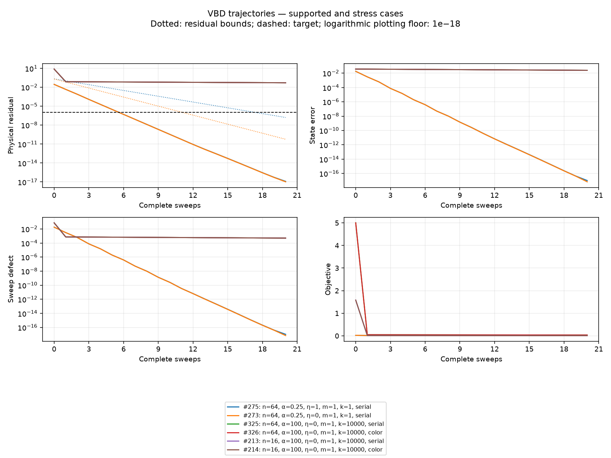

# VBD applicability experiment

336 cases; 20 sweeps; residual target 1e-06.
Uniform certificates: 288; bounds meeting target: 192; observed target hits: 288.

| case | n  | alpha | eta | mass | stiffness | order  | rho    | norm_inf | q      | cert | hit | residual  |
| ---- | -- | ----- | --- | ---- | --------- | ------ | ------ | -------- | ------ | ---- | --- | --------- |
| 1    | 4  | 0.01  | 0   | 1    | 1         | serial | 0.0003 | 0.0099   | 0.0196 | yes  | 2   | 1.301e-18 |
| 2    | 4  | 0.01  | 0   | 1    | 1         | color  | 0.0003 | 0.0196   | 0.0196 | yes  | 2   | 1.301e-18 |
| 3    | 4  | 0.01  | 1   | 1    | 1         | serial | 0.0003 | 0.0100   | 0.0290 | yes  | 2   | 3.253e-18 |
| 4    | 4  | 0.01  | 1   | 1    | 1         | color  | 0.0003 | 0.0198   | 0.0290 | yes  | 2   | 3.253e-18 |
| 5    | 4  | 0.01  | 0   | 1    | 10000     | serial | 0.0001 | 0.0099   | 0.0196 | yes  | 2   | 2.206e-18 |
| 6    | 4  | 0.01  | 0   | 1    | 10000     | color  | 0.0001 | 0.0099   | 0.0196 | yes  | 2   | 2.206e-18 |
| 7    | 4  | 0.01  | 1   | 1    | 10000     | serial | 0.0001 | 0.0100   | 0.0290 | yes  | 2   | 2.711e-18 |
| 8    | 4  | 0.01  | 1   | 1    | 10000     | color  | 0.0001 | 0.0100   | 0.0290 | yes  | 2   | 2.711e-18 |
| 9    | 4  | 0.01  | 0   | 1000 | 1         | serial | 0.0000 | 0.0099   | 0.0196 | yes  | 1   | 1.247e-18 |
| 10   | 4  | 0.01  | 0   | 1000 | 1         | color  | 0.0000 | 0.0196   | 0.0196 | yes  | 1   | 1.247e-18 |
| 11   | 4  | 0.01  | 1   | 1000 | 1         | serial | 0.0000 | 0.0100   | 0.0290 | yes  | 1   | 2.602e-18 |
| 12   | 4  | 0.01  | 1   | 1000 | 1         | color  | 0.0000 | 0.0198   | 0.0290 | yes  | 1   | 2.602e-18 |
| 13   | 4  | 0.01  | 0   | 1000 | 10000     | serial | 0.0000 | 0.0099   | 0.0196 | yes  | 1   | 3.068e-18 |
| 14   | 4  | 0.01  | 0   | 1000 | 10000     | color  | 0.0000 | 0.0099   | 0.0196 | yes  | 1   | 3.068e-18 |
| 15   | 4  | 0.01  | 1   | 1000 | 10000     | serial | 0.0000 | 0.0100   | 0.0290 | yes  | 1   | 7.284e-19 |
| 16   | 4  | 0.01  | 1   | 1000 | 10000     | color  | 0.0000 | 0.0100   | 0.0290 | yes  | 1   | 7.284e-19 |
| 17   | 4  | 0.1   | 0   | 1    | 1         | serial | 0.0191 | 0.0909   | 0.1667 | yes  | 4   | 2.602e-18 |
| 18   | 4  | 0.1   | 0   | 1    | 1         | color  | 0.0191 | 0.1667   | 0.1667 | yes  | 3   | 2.602e-18 |
| 19   | 4  | 0.1   | 1   | 1    | 1         | serial | 0.0193 | 0.0916   | 0.2469 | yes  | 4   | 2.602e-18 |
| 20   | 4  | 0.1   | 1   | 1    | 1         | color  | 0.0193 | 0.1675   | 0.2469 | yes  | 3   | 2.602e-18 |
| 21   | 4  | 0.1   | 0   | 1    | 10000     | serial | 0.0083 | 0.0909   | 0.1667 | yes  | 3   | 3.469e-18 |
| 22   | 4  | 0.1   | 0   | 1    | 10000     | color  | 0.0083 | 0.0909   | 0.1667 | yes  | 3   | 3.469e-18 |
| 23   | 4  | 0.1   | 1   | 1    | 10000     | serial | 0.0084 | 0.0917   | 0.2469 | yes  | 3   | 3.768e-18 |
| 24   | 4  | 0.1   | 1   | 1    | 10000     | color  | 0.0084 | 0.0917   | 0.2469 | yes  | 3   | 3.768e-18 |
| 25   | 4  | 0.1   | 0   | 1000 | 1         | serial | 0.0000 | 0.0909   | 0.1667 | yes  | 1   | 3.903e-18 |
| 26   | 4  | 0.1   | 0   | 1000 | 1         | color  | 0.0000 | 0.1667   | 0.1667 | yes  | 1   | 3.469e-18 |
| 27   | 4  | 0.1   | 1   | 1000 | 1         | serial | 0.0000 | 0.0916   | 0.2469 | yes  | 2   | 1.735e-18 |
| 28   | 4  | 0.1   | 1   | 1000 | 1         | color  | 0.0000 | 0.1676   | 0.2469 | yes  | 2   | 1.735e-18 |
| 29   | 4  | 0.1   | 0   | 1000 | 10000     | serial | 0.0000 | 0.0909   | 0.1667 | yes  | 1   | 2.602e-18 |
| 30   | 4  | 0.1   | 0   | 1000 | 10000     | color  | 0.0000 | 0.0909   | 0.1667 | yes  | 1   | 2.602e-18 |
| 31   | 4  | 0.1   | 1   | 1000 | 10000     | serial | 0.0000 | 0.0918   | 0.2469 | yes  | 1   | 3.469e-18 |
| 32   | 4  | 0.1   | 1   | 1000 | 10000     | color  | 0.0000 | 0.0918   | 0.2469 | yes  | 1   | 3.469e-18 |
| 33   | 4  | 0.2   | 0   | 1    | 1         | serial | 0.0583 | 0.1667   | 0.2857 | yes  | 5   | 1.735e-18 |
| 34   | 4  | 0.2   | 0   | 1    | 1         | color  | 0.0583 | 0.2857   | 0.2857 | yes  | 4   | 1.735e-18 |
| 35   | 4  | 0.2   | 1   | 1    | 1         | serial | 0.0587 | 0.1675   | 0.4236 | yes  | 5   | 3.469e-18 |
| 36   | 4  | 0.2   | 1   | 1    | 1         | color  | 0.0587 | 0.2866   | 0.4236 | yes  | 4   | 3.469e-18 |
| 37   | 4  | 0.2   | 0   | 1    | 10000     | serial | 0.0278 | 0.1667   | 0.2857 | yes  | 4   | 2.631e-18 |
| 38   | 4  | 0.2   | 0   | 1    | 10000     | color  | 0.0278 | 0.1667   | 0.2857 | yes  | 4   | 2.631e-18 |
| 39   | 4  | 0.2   | 1   | 1    | 10000     | serial | 0.0281 | 0.1676   | 0.4236 | yes  | 4   | 1.177e-18 |
| 40   | 4  | 0.2   | 1   | 1    | 10000     | color  | 0.0281 | 0.1676   | 0.4236 | yes  | 4   | 1.177e-18 |
| 41   | 4  | 0.2   | 0   | 1000 | 1         | serial | 0.0001 | 0.1667   | 0.2857 | yes  | 2   | 3.469e-18 |
| 42   | 4  | 0.2   | 0   | 1000 | 1         | color  | 0.0001 | 0.2857   | 0.2857 | yes  | 2   | 3.469e-18 |
| 43   | 4  | 0.2   | 1   | 1000 | 1         | serial | 0.0001 | 0.1676   | 0.4236 | yes  | 2   | 3.469e-18 |
| 44   | 4  | 0.2   | 1   | 1000 | 1         | color  | 0.0001 | 0.2867   | 0.4236 | yes  | 2   | 3.469e-18 |
| 45   | 4  | 0.2   | 0   | 1000 | 10000     | serial | 0.0000 | 0.1667   | 0.2857 | yes  | 2   | 3.469e-18 |
| 46   | 4  | 0.2   | 0   | 1000 | 10000     | color  | 0.0000 | 0.1667   | 0.2857 | yes  | 2   | 3.469e-18 |
| 47   | 4  | 0.2   | 1   | 1000 | 10000     | serial | 0.0000 | 0.1680   | 0.4236 | yes  | 2   | 3.469e-18 |
| 48   | 4  | 0.2   | 1   | 1000 | 10000     | color  | 0.0000 | 0.1680   | 0.4236 | yes  | 2   | 3.469e-18 |
| 49   | 4  | 0.25  | 0   | 1    | 1         | serial | 0.0807 | 0.2000   | 0.3333 | yes  | 5   | 3.469e-18 |
| 50   | 4  | 0.25  | 0   | 1    | 1         | color  | 0.0807 | 0.3333   | 0.3333 | yes  | 4   | 3.469e-18 |
| 51   | 4  | 0.25  | 1   | 1    | 1         | serial | 0.0811 | 0.2009   | 0.4944 | yes  | 5   | 3.469e-18 |
| 52   | 4  | 0.25  | 1   | 1    | 1         | color  | 0.0811 | 0.3341   | 0.4944 | yes  | 4   | 3.469e-18 |
| 53   | 4  | 0.25  | 0   | 1    | 10000     | serial | 0.0400 | 0.2000   | 0.3333 | yes  | 4   | 1.735e-18 |
| 54   | 4  | 0.25  | 0   | 1    | 10000     | color  | 0.0400 | 0.2000   | 0.3333 | yes  | 4   | 1.735e-18 |
| 55   | 4  | 0.25  | 1   | 1    | 10000     | serial | 0.0404 | 0.2010   | 0.4944 | yes  | 4   | 3.710e-18 |
| 56   | 4  | 0.25  | 1   | 1    | 10000     | color  | 0.0404 | 0.2010   | 0.4944 | yes  | 4   | 3.710e-18 |
| 57   | 4  | 0.25  | 0   | 1000 | 1         | serial | 0.0001 | 0.2000   | 0.3333 | yes  | 3   | 1.735e-18 |
| 58   | 4  | 0.25  | 0   | 1000 | 1         | color  | 0.0001 | 0.3333   | 0.3333 | yes  | 2   | 1.735e-18 |
| 59   | 4  | 0.25  | 1   | 1000 | 1         | serial | 0.0001 | 0.2010   | 0.4944 | yes  | 3   | 1.735e-18 |
| 60   | 4  | 0.25  | 1   | 1000 | 1         | color  | 0.0001 | 0.3343   | 0.4944 | yes  | 2   | 1.735e-18 |
| 61   | 4  | 0.25  | 0   | 1000 | 10000     | serial | 0.0000 | 0.2000   | 0.3333 | yes  | 2   | 3.469e-18 |
| 62   | 4  | 0.25  | 0   | 1000 | 10000     | color  | 0.0000 | 0.2000   | 0.3333 | yes  | 2   | 3.469e-18 |
| 63   | 4  | 0.25  | 1   | 1000 | 10000     | serial | 0.0001 | 0.2014   | 0.4944 | yes  | 2   | 3.469e-18 |
| 64   | 4  | 0.25  | 1   | 1000 | 10000     | color  | 0.0001 | 0.2014   | 0.4944 | yes  | 2   | 3.469e-18 |
| 65   | 4  | 1     | 0   | 1    | 1         | serial | 0.3692 | 0.5000   | 0.6667 | yes  | 10  | 2.215e-11 |
| 66   | 4  | 1     | 0   | 1    | 1         | color  | 0.3692 | 0.6667   | 0.6667 | yes  | 9   | 6.761e-12 |
| 67   | 4  | 1     | 1   | 1    | 1         | serial | 0.3695 | 0.5004   | 0.9932 | yes  | 10  | 2.352e-11 |
| 68   | 4  | 1     | 1   | 1    | 1         | color  | 0.3695 | 0.6669   | 0.9932 | yes  | 8   | 6.289e-12 |
| 69   | 4  | 1     | 0   | 1    | 10000     | serial | 0.2500 | 0.5000   | 0.6667 | yes  | 9   | 6.108e-14 |
| 70   | 4  | 1     | 0   | 1    | 10000     | color  | 0.2500 | 0.5000   | 0.6667 | yes  | 9   | 6.099e-14 |
| 71   | 4  | 1     | 1   | 1    | 10000     | serial | 0.2504 | 0.5004   | 0.9932 | yes  | 9   | 6.251e-14 |
| 72   | 4  | 1     | 1   | 1    | 10000     | color  | 0.2504 | 0.5004   | 0.9932 | yes  | 9   | 6.244e-14 |
| 73   | 4  | 1     | 0   | 1000 | 1         | serial | 0.0010 | 0.5000   | 0.6667 | yes  | 3   | 3.469e-18 |
| 74   | 4  | 1     | 0   | 1000 | 1         | color  | 0.0010 | 0.6667   | 0.6667 | yes  | 2   | 3.469e-18 |
| 75   | 4  | 1     | 1   | 1000 | 1         | serial | 0.0010 | 0.5006   | 0.9932 | yes  | 3   | 3.469e-18 |
| 76   | 4  | 1     | 1   | 1000 | 1         | color  | 0.0010 | 0.6670   | 0.9932 | yes  | 2   | 3.469e-18 |
| 77   | 4  | 1     | 0   | 1000 | 10000     | serial | 0.0005 | 0.5000   | 0.6667 | yes  | 2   | 4.795e-18 |
| 78   | 4  | 1     | 0   | 1000 | 10000     | color  | 0.0005 | 0.5000   | 0.6667 | yes  | 2   | 4.795e-18 |
| 79   | 4  | 1     | 1   | 1000 | 10000     | serial | 0.0005 | 0.5008   | 0.9932 | yes  | 2   | 6.939e-18 |
| 80   | 4  | 1     | 1   | 1000 | 10000     | color  | 0.0005 | 0.5009   | 0.9932 | yes  | 2   | 6.939e-18 |
| 81   | 4  | 10    | 0   | 1    | 1         | serial | 0.8795 | 0.9091   | 0.9524 | yes  | —   | 1.528e-03 |
| 82   | 4  | 10    | 0   | 1    | 1         | color  | 0.8795 | 0.9524   | 0.9524 | yes  | —   | 2.199e-04 |
| 83   | 4  | 10    | 1   | 1    | 1         | serial | 0.8795 | 0.9091   | 1.4264 | no   | —   | 1.530e-03 |
| 84   | 4  | 10    | 1   | 1    | 1         | color  | 0.8795 | 0.9524   | 1.4264 | no   | —   | 2.405e-04 |
| 85   | 4  | 10    | 0   | 1    | 10000     | serial | 0.8265 | 0.9091   | 0.9524 | yes  | —   | 1.481e-03 |
| 86   | 4  | 10    | 0   | 1    | 10000     | color  | 0.8265 | 0.9091   | 0.9524 | yes  | —   | 1.481e-03 |
| 87   | 4  | 10    | 1   | 1    | 10000     | serial | 0.8265 | 0.9091   | 1.4264 | no   | —   | 1.458e-03 |
| 88   | 4  | 10    | 1   | 1    | 10000     | color  | 0.8265 | 0.9091   | 1.4264 | no   | —   | 1.457e-03 |
| 89   | 4  | 10    | 0   | 1000 | 1         | serial | 0.0156 | 0.9091   | 0.9524 | yes  | 4   | 5.274e-19 |
| 90   | 4  | 10    | 0   | 1000 | 1         | color  | 0.0156 | 0.9524   | 0.9524 | yes  | 3   | 5.274e-19 |
| 91   | 4  | 10    | 1   | 1000 | 1         | serial | 0.0156 | 0.9091   | 1.4264 | no   | 5   | 1.388e-17 |
| 92   | 4  | 10    | 1   | 1000 | 1         | color  | 0.0156 | 0.9524   | 1.4264 | no   | 3   | 1.388e-17 |
| 93   | 4  | 10    | 0   | 1000 | 10000     | serial | 0.0090 | 0.9091   | 0.9524 | yes  | 3   | 5.228e-18 |
| 94   | 4  | 10    | 0   | 1000 | 10000     | color  | 0.0090 | 0.9091   | 0.9524 | yes  | 3   | 5.228e-18 |
| 95   | 4  | 10    | 1   | 1000 | 10000     | serial | 0.0090 | 0.9091   | 1.4264 | no   | 3   | 3.378e-18 |
| 96   | 4  | 10    | 1   | 1000 | 10000     | color  | 0.0090 | 0.9091   | 1.4264 | no   | 3   | 3.378e-18 |
| 97   | 4  | 100   | 0   | 1    | 1         | serial | 0.9868 | 0.9901   | 0.9950 | yes  | —   | 1.578e-02 |
| 98   | 4  | 100   | 0   | 1    | 1         | color  | 0.9868 | 0.9950   | 0.9950 | yes  | —   | 3.018e-03 |
| 99   | 4  | 100   | 1   | 1    | 1         | serial | 0.9868 | 0.9901   | 1.4916 | no   | —   | 1.576e-02 |
| 100  | 4  | 100   | 1   | 1    | 1         | color  | 0.9868 | 0.9950   | 1.4916 | no   | —   | 3.214e-03 |
| 101  | 4  | 100   | 0   | 1    | 10000     | serial | 0.9803 | 0.9901   | 0.9950 | yes  | —   | 4.517e-02 |
| 102  | 4  | 100   | 0   | 1    | 10000     | color  | 0.9803 | 0.9901   | 0.9950 | yes  | —   | 4.517e-02 |
| 103  | 4  | 100   | 1   | 1    | 10000     | serial | 0.9803 | 0.9901   | 1.4916 | no   | —   | 4.437e-02 |
| 104  | 4  | 100   | 1   | 1    | 10000     | color  | 0.9803 | 0.9901   | 1.4916 | no   | —   | 4.436e-02 |
| 105  | 4  | 100   | 0   | 1000 | 1         | serial | 0.1431 | 0.9901   | 0.9950 | yes  | 9   | 2.845e-16 |
| 106  | 4  | 100   | 0   | 1000 | 1         | color  | 0.1431 | 0.9950   | 0.9950 | yes  | 7   | 2.220e-16 |
| 107  | 4  | 100   | 1   | 1000 | 1         | serial | 0.1431 | 0.9901   | 1.4916 | no   | 9   | 2.220e-16 |
| 108  | 4  | 100   | 1   | 1000 | 1         | color  | 0.1431 | 0.9950   | 1.4916 | no   | 7   | 2.220e-16 |
| 109  | 4  | 100   | 0   | 1000 | 10000     | serial | 0.0900 | 0.9901   | 0.9950 | yes  | 5   | 3.226e-17 |
| 110  | 4  | 100   | 0   | 1000 | 10000     | color  | 0.0900 | 0.9901   | 0.9950 | yes  | 5   | 3.226e-17 |
| 111  | 4  | 100   | 1   | 1000 | 10000     | serial | 0.0900 | 0.9901   | 1.4916 | no   | 6   | 1.628e-16 |
| 112  | 4  | 100   | 1   | 1000 | 10000     | color  | 0.0900 | 0.9901   | 1.4916 | no   | 6   | 1.628e-16 |
| 113  | 16 | 0.01  | 0   | 1    | 1         | serial | 0.0004 | 0.0099   | 0.0196 | yes  | 2   | 3.253e-18 |
| 114  | 16 | 0.01  | 0   | 1    | 1         | color  | 0.0004 | 0.0196   | 0.0196 | yes  | 2   | 3.253e-18 |
| 115  | 16 | 0.01  | 1   | 1    | 1         | serial | 0.0004 | 0.0101   | 0.0290 | yes  | 2   | 3.469e-18 |
| 116  | 16 | 0.01  | 1   | 1    | 1         | color  | 0.0004 | 0.0198   | 0.0290 | yes  | 2   | 3.469e-18 |
| 117  | 16 | 0.01  | 0   | 1    | 10000     | serial | 0.0001 | 0.0099   | 0.0196 | yes  | 2   | 3.361e-18 |
| 118  | 16 | 0.01  | 0   | 1    | 10000     | color  | 0.0001 | 0.0099   | 0.0196 | yes  | 2   | 3.361e-18 |
| 119  | 16 | 0.01  | 1   | 1    | 10000     | serial | 0.0001 | 0.0101   | 0.0290 | yes  | 2   | 3.469e-18 |
| 120  | 16 | 0.01  | 1   | 1    | 10000     | color  | 0.0001 | 0.0101   | 0.0290 | yes  | 2   | 3.469e-18 |
| 121  | 16 | 0.01  | 0   | 1000 | 1         | serial | 0.0000 | 0.0099   | 0.0196 | yes  | 1   | 3.081e-18 |
| 122  | 16 | 0.01  | 0   | 1000 | 1         | color  | 0.0000 | 0.0196   | 0.0196 | yes  | 1   | 3.081e-18 |
| 123  | 16 | 0.01  | 1   | 1000 | 1         | serial | 0.0000 | 0.0100   | 0.0290 | yes  | 1   | 3.463e-18 |
| 124  | 16 | 0.01  | 1   | 1000 | 1         | color  | 0.0000 | 0.0198   | 0.0290 | yes  | 1   | 3.463e-18 |
| 125  | 16 | 0.01  | 0   | 1000 | 10000     | serial | 0.0000 | 0.0099   | 0.0196 | yes  | 1   | 3.131e-18 |
| 126  | 16 | 0.01  | 0   | 1000 | 10000     | color  | 0.0000 | 0.0099   | 0.0196 | yes  | 1   | 3.131e-18 |
| 127  | 16 | 0.01  | 1   | 1000 | 10000     | serial | 0.0000 | 0.0101   | 0.0290 | yes  | 1   | 3.449e-18 |
| 128  | 16 | 0.01  | 1   | 1000 | 10000     | color  | 0.0000 | 0.0101   | 0.0290 | yes  | 1   | 3.449e-18 |
| 129  | 16 | 0.1   | 0   | 1    | 1         | serial | 0.0269 | 0.0909   | 0.1667 | yes  | 4   | 2.602e-18 |
| 130  | 16 | 0.1   | 0   | 1    | 1         | color  | 0.0269 | 0.1667   | 0.1667 | yes  | 3   | 2.602e-18 |
| 131  | 16 | 0.1   | 1   | 1    | 1         | serial | 0.0271 | 0.0918   | 0.2469 | yes  | 4   | 4.337e-18 |
| 132  | 16 | 0.1   | 1   | 1    | 1         | color  | 0.0271 | 0.1675   | 0.2469 | yes  | 3   | 4.337e-18 |
| 133  | 16 | 0.1   | 0   | 1    | 10000     | serial | 0.0083 | 0.0909   | 0.1667 | yes  | 3   | 3.469e-18 |
| 134  | 16 | 0.1   | 0   | 1    | 10000     | color  | 0.0083 | 0.0909   | 0.1667 | yes  | 3   | 3.469e-18 |
| 135  | 16 | 0.1   | 1   | 1    | 10000     | serial | 0.0084 | 0.0919   | 0.2469 | yes  | 3   | 3.619e-18 |
| 136  | 16 | 0.1   | 1   | 1    | 10000     | color  | 0.0084 | 0.0919   | 0.2469 | yes  | 3   | 3.619e-18 |
| 137  | 16 | 0.1   | 0   | 1000 | 1         | serial | 0.0000 | 0.0909   | 0.1667 | yes  | 2   | 3.036e-18 |
| 138  | 16 | 0.1   | 0   | 1000 | 1         | color  | 0.0000 | 0.1667   | 0.1667 | yes  | 1   | 3.036e-18 |
| 139  | 16 | 0.1   | 1   | 1000 | 1         | serial | 0.0000 | 0.0916   | 0.2469 | yes  | 2   | 3.358e-18 |
| 140  | 16 | 0.1   | 1   | 1000 | 1         | color  | 0.0000 | 0.1677   | 0.2469 | yes  | 2   | 3.358e-18 |
| 141  | 16 | 0.1   | 0   | 1000 | 10000     | serial | 0.0000 | 0.0909   | 0.1667 | yes  | 1   | 3.657e-18 |
| 142  | 16 | 0.1   | 0   | 1000 | 10000     | color  | 0.0000 | 0.0909   | 0.1667 | yes  | 1   | 3.657e-18 |
| 143  | 16 | 0.1   | 1   | 1000 | 10000     | serial | 0.0000 | 0.0921   | 0.2469 | yes  | 1   | 3.815e-18 |
| 144  | 16 | 0.1   | 1   | 1000 | 10000     | color  | 0.0000 | 0.0921   | 0.2469 | yes  | 1   | 3.815e-18 |
| 145  | 16 | 0.2   | 0   | 1    | 1         | serial | 0.0791 | 0.1667   | 0.2857 | yes  | 6   | 6.939e-18 |
| 146  | 16 | 0.2   | 0   | 1    | 1         | color  | 0.0791 | 0.2857   | 0.2857 | yes  | 4   | 5.204e-18 |
| 147  | 16 | 0.2   | 1   | 1    | 1         | serial | 0.0796 | 0.1676   | 0.4236 | yes  | 6   | 5.204e-18 |
| 148  | 16 | 0.2   | 1   | 1    | 1         | color  | 0.0796 | 0.2866   | 0.4236 | yes  | 4   | 4.337e-18 |
| 149  | 16 | 0.2   | 0   | 1    | 10000     | serial | 0.0278 | 0.1667   | 0.2857 | yes  | 4   | 3.469e-18 |
| 150  | 16 | 0.2   | 0   | 1    | 10000     | color  | 0.0278 | 0.1667   | 0.2857 | yes  | 4   | 3.469e-18 |
| 151  | 16 | 0.2   | 1   | 1    | 10000     | serial | 0.0282 | 0.1679   | 0.4236 | yes  | 4   | 4.337e-18 |
| 152  | 16 | 0.2   | 1   | 1    | 10000     | color  | 0.0282 | 0.1679   | 0.4236 | yes  | 4   | 4.337e-18 |
| 153  | 16 | 0.2   | 0   | 1000 | 1         | serial | 0.0001 | 0.1667   | 0.2857 | yes  | 2   | 5.204e-18 |
| 154  | 16 | 0.2   | 0   | 1000 | 1         | color  | 0.0001 | 0.2857   | 0.2857 | yes  | 2   | 5.204e-18 |
| 155  | 16 | 0.2   | 1   | 1000 | 1         | serial | 0.0001 | 0.1676   | 0.4236 | yes  | 2   | 4.337e-18 |
| 156  | 16 | 0.2   | 1   | 1000 | 1         | color  | 0.0001 | 0.2872   | 0.4236 | yes  | 2   | 4.337e-18 |
| 157  | 16 | 0.2   | 0   | 1000 | 10000     | serial | 0.0000 | 0.1667   | 0.2857 | yes  | 2   | 3.469e-18 |
| 158  | 16 | 0.2   | 0   | 1000 | 10000     | color  | 0.0000 | 0.1667   | 0.2857 | yes  | 2   | 3.469e-18 |
| 159  | 16 | 0.2   | 1   | 1000 | 10000     | serial | 0.0000 | 0.1683   | 0.4236 | yes  | 2   | 3.720e-18 |
| 160  | 16 | 0.2   | 1   | 1000 | 10000     | color  | 0.0000 | 0.1683   | 0.4236 | yes  | 2   | 3.720e-18 |
| 161  | 16 | 0.25  | 0   | 1    | 1         | serial | 0.1077 | 0.2000   | 0.3333 | yes  | 6   | 3.469e-18 |
| 162  | 16 | 0.25  | 0   | 1    | 1         | color  | 0.1077 | 0.3333   | 0.3333 | yes  | 4   | 3.469e-18 |
| 163  | 16 | 0.25  | 1   | 1    | 1         | serial | 0.1082 | 0.2009   | 0.4944 | yes  | 6   | 8.674e-18 |
| 164  | 16 | 0.25  | 1   | 1    | 1         | color  | 0.1082 | 0.3342   | 0.4944 | yes  | 4   | 3.469e-18 |
| 165  | 16 | 0.25  | 0   | 1    | 10000     | serial | 0.0400 | 0.2000   | 0.3333 | yes  | 4   | 3.700e-18 |
| 166  | 16 | 0.25  | 0   | 1    | 10000     | color  | 0.0400 | 0.2000   | 0.3333 | yes  | 4   | 3.700e-18 |
| 167  | 16 | 0.25  | 1   | 1    | 10000     | serial | 0.0405 | 0.2012   | 0.4944 | yes  | 4   | 4.236e-18 |
| 168  | 16 | 0.25  | 1   | 1    | 10000     | color  | 0.0405 | 0.2012   | 0.4944 | yes  | 4   | 4.236e-18 |
| 169  | 16 | 0.25  | 0   | 1000 | 1         | serial | 0.0002 | 0.2000   | 0.3333 | yes  | 3   | 3.469e-18 |
| 170  | 16 | 0.25  | 0   | 1000 | 1         | color  | 0.0002 | 0.3333   | 0.3333 | yes  | 2   | 3.469e-18 |
| 171  | 16 | 0.25  | 1   | 1000 | 1         | serial | 0.0002 | 0.2010   | 0.4944 | yes  | 3   | 2.510e-18 |
| 172  | 16 | 0.25  | 1   | 1000 | 1         | color  | 0.0002 | 0.3350   | 0.4944 | yes  | 2   | 2.510e-18 |
| 173  | 16 | 0.25  | 0   | 1000 | 10000     | serial | 0.0000 | 0.2000   | 0.3333 | yes  | 2   | 3.469e-18 |
| 174  | 16 | 0.25  | 0   | 1000 | 10000     | color  | 0.0000 | 0.2000   | 0.3333 | yes  | 2   | 3.469e-18 |
| 175  | 16 | 0.25  | 1   | 1000 | 10000     | serial | 0.0001 | 0.2017   | 0.4944 | yes  | 2   | 4.015e-18 |
| 176  | 16 | 0.25  | 1   | 1000 | 10000     | color  | 0.0001 | 0.2017   | 0.4944 | yes  | 2   | 4.015e-18 |
| 177  | 16 | 1     | 0   | 1    | 1         | serial | 0.4343 | 0.5000   | 0.6667 | yes  | 11  | 7.077e-10 |
| 178  | 16 | 1     | 0   | 1    | 1         | color  | 0.4343 | 0.6667   | 0.6667 | yes  | 11  | 2.483e-10 |
| 179  | 16 | 1     | 1   | 1    | 1         | serial | 0.4345 | 0.5004   | 0.9932 | yes  | 11  | 7.222e-10 |
| 180  | 16 | 1     | 1   | 1    | 1         | color  | 0.4345 | 0.6669   | 0.9932 | yes  | 11  | 2.536e-10 |
| 181  | 16 | 1     | 0   | 1    | 10000     | serial | 0.2500 | 0.5000   | 0.6667 | yes  | 9   | 6.763e-14 |
| 182  | 16 | 1     | 0   | 1    | 10000     | color  | 0.2500 | 0.5000   | 0.6667 | yes  | 9   | 6.785e-14 |
| 183  | 16 | 1     | 1   | 1    | 10000     | serial | 0.2505 | 0.5005   | 0.9932 | yes  | 9   | 6.961e-14 |
| 184  | 16 | 1     | 1   | 1    | 10000     | color  | 0.2505 | 0.5005   | 0.9932 | yes  | 9   | 6.985e-14 |
| 185  | 16 | 1     | 0   | 1000 | 1         | serial | 0.0013 | 0.5000   | 0.6667 | yes  | 3   | 6.939e-18 |
| 186  | 16 | 1     | 0   | 1000 | 1         | color  | 0.0013 | 0.6667   | 0.6667 | yes  | 2   | 6.939e-18 |
| 187  | 16 | 1     | 1   | 1000 | 1         | serial | 0.0013 | 0.5006   | 0.9932 | yes  | 3   | 6.939e-18 |
| 188  | 16 | 1     | 1   | 1000 | 1         | color  | 0.0013 | 0.6683   | 0.9932 | yes  | 2   | 6.939e-18 |
| 189  | 16 | 1     | 0   | 1000 | 10000     | serial | 0.0005 | 0.5000   | 0.6667 | yes  | 2   | 7.749e-18 |
| 190  | 16 | 1     | 0   | 1000 | 10000     | color  | 0.0005 | 0.5000   | 0.6667 | yes  | 2   | 1.165e-17 |
| 191  | 16 | 1     | 1   | 1000 | 10000     | serial | 0.0005 | 0.5010   | 0.9932 | yes  | 2   | 1.181e-17 |
| 192  | 16 | 1     | 1   | 1000 | 10000     | color  | 0.0005 | 0.5011   | 0.9932 | yes  | 2   | 4.074e-18 |
| 193  | 16 | 10    | 0   | 1    | 1         | serial | 0.9019 | 0.9091   | 0.9524 | yes  | —   | 8.395e-04 |
| 194  | 16 | 10    | 0   | 1    | 1         | color  | 0.9019 | 0.9524   | 0.9524 | yes  | —   | 9.999e-04 |
| 195  | 16 | 10    | 1   | 1    | 1         | serial | 0.9019 | 0.9091   | 1.4264 | no   | —   | 8.351e-04 |
| 196  | 16 | 10    | 1   | 1    | 1         | color  | 0.9019 | 0.9524   | 1.4264 | no   | —   | 1.001e-03 |
| 197  | 16 | 10    | 0   | 1    | 10000     | serial | 0.8265 | 0.9091   | 0.9524 | yes  | —   | 1.649e-03 |
| 198  | 16 | 10    | 0   | 1    | 10000     | color  | 0.8265 | 0.9091   | 0.9524 | yes  | —   | 1.649e-03 |
| 199  | 16 | 10    | 1   | 1    | 10000     | serial | 0.8265 | 0.9091   | 1.4264 | no   | —   | 1.616e-03 |
| 200  | 16 | 10    | 1   | 1    | 10000     | color  | 0.8265 | 0.9091   | 1.4264 | no   | —   | 1.616e-03 |
| 201  | 16 | 10    | 0   | 1000 | 1         | serial | 0.0184 | 0.9091   | 0.9524 | yes  | 5   | 1.110e-16 |
| 202  | 16 | 10    | 0   | 1000 | 1         | color  | 0.0184 | 0.9524   | 0.9524 | yes  | 3   | 1.110e-16 |
| 203  | 16 | 10    | 1   | 1000 | 1         | serial | 0.0185 | 0.9091   | 1.4264 | no   | 5   | 5.551e-17 |
| 204  | 16 | 10    | 1   | 1000 | 1         | color  | 0.0185 | 0.9527   | 1.4264 | no   | 3   | 5.551e-17 |
| 205  | 16 | 10    | 0   | 1000 | 10000     | serial | 0.0090 | 0.9091   | 0.9524 | yes  | 3   | 3.154e-17 |
| 206  | 16 | 10    | 0   | 1000 | 10000     | color  | 0.0090 | 0.9091   | 0.9524 | yes  | 3   | 3.154e-17 |
| 207  | 16 | 10    | 1   | 1000 | 10000     | serial | 0.0090 | 0.9091   | 1.4264 | no   | 3   | 3.169e-17 |
| 208  | 16 | 10    | 1   | 1000 | 10000     | color  | 0.0090 | 0.9091   | 1.4264 | no   | 3   | 3.169e-17 |
| 209  | 16 | 100   | 0   | 1    | 1         | serial | 0.9894 | 0.9901   | 0.9950 | yes  | —   | 1.460e-02 |
| 210  | 16 | 100   | 0   | 1    | 1         | color  | 0.9894 | 0.9950   | 0.9950 | yes  | —   | 8.555e-03 |
| 211  | 16 | 100   | 1   | 1    | 1         | serial | 0.9894 | 0.9901   | 1.4916 | no   | —   | 1.447e-02 |
| 212  | 16 | 100   | 1   | 1    | 1         | color  | 0.9894 | 0.9950   | 1.4916 | no   | —   | 8.551e-03 |
| 213  | 16 | 100   | 0   | 1    | 10000     | serial | 0.9803 | 0.9901   | 0.9950 | yes  | —   | 5.104e-02 |
| 214  | 16 | 100   | 0   | 1    | 10000     | color  | 0.9803 | 0.9901   | 0.9950 | yes  | —   | 5.103e-02 |
| 215  | 16 | 100   | 1   | 1    | 10000     | serial | 0.9803 | 0.9901   | 1.4916 | no   | —   | 4.993e-02 |
| 216  | 16 | 100   | 1   | 1    | 10000     | color  | 0.9803 | 0.9901   | 1.4916 | no   | —   | 4.991e-02 |
| 217  | 16 | 100   | 0   | 1000 | 1         | serial | 0.1642 | 0.9901   | 0.9950 | yes  | 10  | 3.268e-13 |
| 218  | 16 | 100   | 0   | 1000 | 1         | color  | 0.1642 | 0.9950   | 0.9950 | yes  | 8   | 8.882e-16 |
| 219  | 16 | 100   | 1   | 1000 | 1         | serial | 0.1645 | 0.9901   | 1.4916 | no   | 10  | 3.382e-13 |
| 220  | 16 | 100   | 1   | 1000 | 1         | color  | 0.1645 | 0.9951   | 1.4916 | no   | 8   | 8.882e-16 |
| 221  | 16 | 100   | 0   | 1000 | 10000     | serial | 0.0900 | 0.9901   | 0.9950 | yes  | 5   | 3.381e-16 |
| 222  | 16 | 100   | 0   | 1000 | 10000     | color  | 0.0900 | 0.9901   | 0.9950 | yes  | 5   | 3.381e-16 |
| 223  | 16 | 100   | 1   | 1000 | 10000     | serial | 0.0900 | 0.9901   | 1.4916 | no   | 6   | 3.215e-16 |
| 224  | 16 | 100   | 1   | 1000 | 10000     | color  | 0.0900 | 0.9901   | 1.4916 | no   | 6   | 3.215e-16 |
| 225  | 64 | 0.01  | 0   | 1    | 1         | serial | 0.0004 | 0.0099   | 0.0196 | yes  | 2   | 3.469e-18 |
| 226  | 64 | 0.01  | 0   | 1    | 1         | color  | 0.0004 | 0.0196   | 0.0196 | yes  | 2   | 3.469e-18 |
| 227  | 64 | 0.01  | 1   | 1    | 1         | serial | 0.0004 | 0.0101   | 0.0290 | yes  | 2   | 3.469e-18 |
| 228  | 64 | 0.01  | 1   | 1    | 1         | color  | 0.0004 | 0.0198   | 0.0290 | yes  | 2   | 3.469e-18 |
| 229  | 64 | 0.01  | 0   | 1    | 10000     | serial | 0.0001 | 0.0099   | 0.0196 | yes  | 2   | 3.469e-18 |
| 230  | 64 | 0.01  | 0   | 1    | 10000     | color  | 0.0001 | 0.0099   | 0.0196 | yes  | 2   | 3.469e-18 |
| 231  | 64 | 0.01  | 1   | 1    | 10000     | serial | 0.0001 | 0.0101   | 0.0290 | yes  | 2   | 3.289e-18 |
| 232  | 64 | 0.01  | 1   | 1    | 10000     | color  | 0.0001 | 0.0101   | 0.0290 | yes  | 2   | 3.289e-18 |
| 233  | 64 | 0.01  | 0   | 1000 | 1         | serial | 0.0000 | 0.0099   | 0.0196 | yes  | 1   | 3.469e-18 |
| 234  | 64 | 0.01  | 0   | 1000 | 1         | color  | 0.0000 | 0.0196   | 0.0196 | yes  | 1   | 3.469e-18 |
| 235  | 64 | 0.01  | 1   | 1000 | 1         | serial | 0.0000 | 0.0100   | 0.0290 | yes  | 1   | 3.463e-18 |
| 236  | 64 | 0.01  | 1   | 1000 | 1         | color  | 0.0000 | 0.0198   | 0.0290 | yes  | 1   | 3.463e-18 |
| 237  | 64 | 0.01  | 0   | 1000 | 10000     | serial | 0.0000 | 0.0099   | 0.0196 | yes  | 1   | 3.216e-18 |
| 238  | 64 | 0.01  | 0   | 1000 | 10000     | color  | 0.0000 | 0.0099   | 0.0196 | yes  | 1   | 3.216e-18 |
| 239  | 64 | 0.01  | 1   | 1000 | 10000     | serial | 0.0000 | 0.0101   | 0.0290 | yes  | 1   | 3.455e-18 |
| 240  | 64 | 0.01  | 1   | 1000 | 10000     | color  | 0.0000 | 0.0101   | 0.0290 | yes  | 1   | 3.455e-18 |
| 241  | 64 | 0.1   | 0   | 1    | 1         | serial | 0.0277 | 0.0909   | 0.1667 | yes  | 4   | 5.204e-18 |
| 242  | 64 | 0.1   | 0   | 1    | 1         | color  | 0.0277 | 0.1667   | 0.1667 | yes  | 3   | 4.337e-18 |
| 243  | 64 | 0.1   | 1   | 1    | 1         | serial | 0.0280 | 0.0918   | 0.2469 | yes  | 4   | 4.337e-18 |
| 244  | 64 | 0.1   | 1   | 1    | 1         | color  | 0.0280 | 0.1675   | 0.2469 | yes  | 3   | 4.337e-18 |
| 245  | 64 | 0.1   | 0   | 1    | 10000     | serial | 0.0083 | 0.0909   | 0.1667 | yes  | 3   | 4.337e-18 |
| 246  | 64 | 0.1   | 0   | 1    | 10000     | color  | 0.0083 | 0.0909   | 0.1667 | yes  | 3   | 4.337e-18 |
| 247  | 64 | 0.1   | 1   | 1    | 10000     | serial | 0.0084 | 0.0919   | 0.2469 | yes  | 3   | 3.619e-18 |
| 248  | 64 | 0.1   | 1   | 1    | 10000     | color  | 0.0084 | 0.0919   | 0.2469 | yes  | 3   | 3.619e-18 |
| 249  | 64 | 0.1   | 0   | 1000 | 1         | serial | 0.0000 | 0.0909   | 0.1667 | yes  | 2   | 4.337e-18 |
| 250  | 64 | 0.1   | 0   | 1000 | 1         | color  | 0.0000 | 0.1667   | 0.1667 | yes  | 1   | 4.337e-18 |
| 251  | 64 | 0.1   | 1   | 1000 | 1         | serial | 0.0000 | 0.0916   | 0.2469 | yes  | 2   | 4.337e-18 |
| 252  | 64 | 0.1   | 1   | 1000 | 1         | color  | 0.0000 | 0.1677   | 0.2469 | yes  | 2   | 5.204e-18 |
| 253  | 64 | 0.1   | 0   | 1000 | 10000     | serial | 0.0000 | 0.0909   | 0.1667 | yes  | 1   | 3.804e-18 |
| 254  | 64 | 0.1   | 0   | 1000 | 10000     | color  | 0.0000 | 0.0909   | 0.1667 | yes  | 1   | 3.804e-18 |
| 255  | 64 | 0.1   | 1   | 1000 | 10000     | serial | 0.0000 | 0.0921   | 0.2469 | yes  | 1   | 3.815e-18 |
| 256  | 64 | 0.1   | 1   | 1000 | 10000     | color  | 0.0000 | 0.0921   | 0.2469 | yes  | 1   | 3.815e-18 |
| 257  | 64 | 0.2   | 0   | 1    | 1         | serial | 0.0814 | 0.1667   | 0.2857 | yes  | 6   | 6.072e-18 |
| 258  | 64 | 0.2   | 0   | 1    | 1         | color  | 0.0814 | 0.2857   | 0.2857 | yes  | 4   | 6.939e-18 |
| 259  | 64 | 0.2   | 1   | 1    | 1         | serial | 0.0819 | 0.1676   | 0.4236 | yes  | 6   | 5.204e-18 |
| 260  | 64 | 0.2   | 1   | 1    | 1         | color  | 0.0819 | 0.2866   | 0.4236 | yes  | 4   | 5.204e-18 |
| 261  | 64 | 0.2   | 0   | 1    | 10000     | serial | 0.0278 | 0.1667   | 0.2857 | yes  | 4   | 4.337e-18 |
| 262  | 64 | 0.2   | 0   | 1    | 10000     | color  | 0.0278 | 0.1667   | 0.2857 | yes  | 4   | 4.337e-18 |
| 263  | 64 | 0.2   | 1   | 1    | 10000     | serial | 0.0282 | 0.1679   | 0.4236 | yes  | 4   | 4.337e-18 |
| 264  | 64 | 0.2   | 1   | 1    | 10000     | color  | 0.0282 | 0.1679   | 0.4236 | yes  | 4   | 4.337e-18 |
| 265  | 64 | 0.2   | 0   | 1000 | 1         | serial | 0.0001 | 0.1667   | 0.2857 | yes  | 2   | 5.204e-18 |
| 266  | 64 | 0.2   | 0   | 1000 | 1         | color  | 0.0001 | 0.2857   | 0.2857 | yes  | 2   | 5.204e-18 |
| 267  | 64 | 0.2   | 1   | 1000 | 1         | serial | 0.0001 | 0.1676   | 0.4236 | yes  | 2   | 5.204e-18 |
| 268  | 64 | 0.2   | 1   | 1000 | 1         | color  | 0.0001 | 0.2872   | 0.4236 | yes  | 2   | 5.204e-18 |
| 269  | 64 | 0.2   | 0   | 1000 | 10000     | serial | 0.0000 | 0.1667   | 0.2857 | yes  | 2   | 4.336e-18 |
| 270  | 64 | 0.2   | 0   | 1000 | 10000     | color  | 0.0000 | 0.1667   | 0.2857 | yes  | 2   | 4.336e-18 |
| 271  | 64 | 0.2   | 1   | 1000 | 10000     | serial | 0.0000 | 0.1683   | 0.4236 | yes  | 2   | 4.033e-18 |
| 272  | 64 | 0.2   | 1   | 1000 | 10000     | color  | 0.0000 | 0.1683   | 0.4236 | yes  | 2   | 4.033e-18 |
| 273  | 64 | 0.25  | 0   | 1    | 1         | serial | 0.1109 | 0.2000   | 0.3333 | yes  | 6   | 1.041e-17 |
| 274  | 64 | 0.25  | 0   | 1    | 1         | color  | 0.1109 | 0.3333   | 0.3333 | yes  | 4   | 4.337e-18 |
| 275  | 64 | 0.25  | 1   | 1    | 1         | serial | 0.1114 | 0.2009   | 0.4944 | yes  | 6   | 1.214e-17 |
| 276  | 64 | 0.25  | 1   | 1    | 1         | color  | 0.1114 | 0.3342   | 0.4944 | yes  | 4   | 5.204e-18 |
| 277  | 64 | 0.25  | 0   | 1    | 10000     | serial | 0.0400 | 0.2000   | 0.3333 | yes  | 4   | 4.337e-18 |
| 278  | 64 | 0.25  | 0   | 1    | 10000     | color  | 0.0400 | 0.2000   | 0.3333 | yes  | 4   | 4.337e-18 |
| 279  | 64 | 0.25  | 1   | 1    | 10000     | serial | 0.0405 | 0.2012   | 0.4944 | yes  | 4   | 4.236e-18 |
| 280  | 64 | 0.25  | 1   | 1    | 10000     | color  | 0.0405 | 0.2012   | 0.4944 | yes  | 4   | 4.236e-18 |
| 281  | 64 | 0.25  | 0   | 1000 | 1         | serial | 0.0002 | 0.2000   | 0.3333 | yes  | 3   | 3.469e-18 |
| 282  | 64 | 0.25  | 0   | 1000 | 1         | color  | 0.0002 | 0.3333   | 0.3333 | yes  | 2   | 3.469e-18 |
| 283  | 64 | 0.25  | 1   | 1000 | 1         | serial | 0.0002 | 0.2010   | 0.4944 | yes  | 3   | 3.469e-18 |
| 284  | 64 | 0.25  | 1   | 1000 | 1         | color  | 0.0002 | 0.3350   | 0.4944 | yes  | 2   | 3.469e-18 |
| 285  | 64 | 0.25  | 0   | 1000 | 10000     | serial | 0.0000 | 0.2000   | 0.3333 | yes  | 2   | 4.025e-18 |
| 286  | 64 | 0.25  | 0   | 1000 | 10000     | color  | 0.0000 | 0.2000   | 0.3333 | yes  | 2   | 4.025e-18 |
| 287  | 64 | 0.25  | 1   | 1000 | 10000     | serial | 0.0001 | 0.2017   | 0.4944 | yes  | 2   | 4.015e-18 |
| 288  | 64 | 0.25  | 1   | 1000 | 10000     | color  | 0.0001 | 0.2017   | 0.4944 | yes  | 2   | 4.015e-18 |
| 289  | 64 | 1     | 0   | 1    | 1         | serial | 0.4435 | 0.5000   | 0.6667 | yes  | 11  | 5.632e-10 |
| 290  | 64 | 1     | 0   | 1    | 1         | color  | 0.4435 | 0.6667   | 0.6667 | yes  | 11  | 1.919e-10 |
| 291  | 64 | 1     | 1   | 1    | 1         | serial | 0.4438 | 0.5004   | 0.9932 | yes  | 11  | 5.715e-10 |
| 292  | 64 | 1     | 1   | 1    | 1         | color  | 0.4438 | 0.6669   | 0.9932 | yes  | 11  | 1.960e-10 |
| 293  | 64 | 1     | 0   | 1    | 10000     | serial | 0.2500 | 0.5000   | 0.6667 | yes  | 9   | 6.771e-14 |
| 294  | 64 | 1     | 0   | 1    | 10000     | color  | 0.2500 | 0.5000   | 0.6667 | yes  | 9   | 6.794e-14 |
| 295  | 64 | 1     | 1   | 1    | 10000     | serial | 0.2505 | 0.5005   | 0.9932 | yes  | 9   | 6.972e-14 |
| 296  | 64 | 1     | 1   | 1    | 10000     | color  | 0.2505 | 0.5005   | 0.9932 | yes  | 9   | 6.996e-14 |
| 297  | 64 | 1     | 0   | 1000 | 1         | serial | 0.0013 | 0.5000   | 0.6667 | yes  | 3   | 6.939e-18 |
| 298  | 64 | 1     | 0   | 1000 | 1         | color  | 0.0013 | 0.6667   | 0.6667 | yes  | 2   | 6.939e-18 |
| 299  | 64 | 1     | 1   | 1000 | 1         | serial | 0.0013 | 0.5006   | 0.9932 | yes  | 3   | 6.939e-18 |
| 300  | 64 | 1     | 1   | 1000 | 1         | color  | 0.0013 | 0.6683   | 0.9932 | yes  | 2   | 6.939e-18 |
| 301  | 64 | 1     | 0   | 1000 | 10000     | serial | 0.0005 | 0.5000   | 0.6667 | yes  | 2   | 1.108e-17 |
| 302  | 64 | 1     | 0   | 1000 | 10000     | color  | 0.0005 | 0.5000   | 0.6667 | yes  | 2   | 1.165e-17 |
| 303  | 64 | 1     | 1   | 1000 | 10000     | serial | 0.0005 | 0.5010   | 0.9932 | yes  | 2   | 1.181e-17 |
| 304  | 64 | 1     | 1   | 1000 | 10000     | color  | 0.0005 | 0.5011   | 0.9932 | yes  | 2   | 9.722e-18 |
| 305  | 64 | 10    | 0   | 1    | 1         | serial | 0.9061 | 0.9091   | 0.9524 | yes  | —   | 7.488e-04 |
| 306  | 64 | 10    | 0   | 1    | 1         | color  | 0.9061 | 0.9524   | 0.9524 | yes  | —   | 8.555e-04 |
| 307  | 64 | 10    | 1   | 1    | 1         | serial | 0.9061 | 0.9091   | 1.4264 | no   | —   | 7.449e-04 |
| 308  | 64 | 10    | 1   | 1    | 1         | color  | 0.9061 | 0.9524   | 1.4264 | no   | —   | 8.570e-04 |
| 309  | 64 | 10    | 0   | 1    | 10000     | serial | 0.8265 | 0.9091   | 0.9524 | yes  | —   | 1.651e-03 |
| 310  | 64 | 10    | 0   | 1    | 10000     | color  | 0.8265 | 0.9091   | 0.9524 | yes  | —   | 1.651e-03 |
| 311  | 64 | 10    | 1   | 1    | 10000     | serial | 0.8265 | 0.9091   | 1.4264 | no   | —   | 1.618e-03 |
| 312  | 64 | 10    | 1   | 1    | 10000     | color  | 0.8265 | 0.9091   | 1.4264 | no   | —   | 1.618e-03 |
| 313  | 64 | 10    | 0   | 1000 | 1         | serial | 0.0186 | 0.9091   | 0.9524 | yes  | 5   | 1.110e-16 |
| 314  | 64 | 10    | 0   | 1000 | 1         | color  | 0.0186 | 0.9524   | 0.9524 | yes  | 3   | 1.110e-16 |
| 315  | 64 | 10    | 1   | 1000 | 1         | serial | 0.0187 | 0.9091   | 1.4264 | no   | 5   | 1.110e-16 |
| 316  | 64 | 10    | 1   | 1000 | 1         | color  | 0.0187 | 0.9527   | 1.4264 | no   | 3   | 1.110e-16 |
| 317  | 64 | 10    | 0   | 1000 | 10000     | serial | 0.0090 | 0.9091   | 0.9524 | yes  | 3   | 3.769e-17 |
| 318  | 64 | 10    | 0   | 1000 | 10000     | color  | 0.0090 | 0.9091   | 0.9524 | yes  | 3   | 3.769e-17 |
| 319  | 64 | 10    | 1   | 1000 | 10000     | serial | 0.0090 | 0.9091   | 1.4264 | no   | 3   | 3.757e-17 |
| 320  | 64 | 10    | 1   | 1000 | 10000     | color  | 0.0090 | 0.9091   | 1.4264 | no   | 3   | 3.757e-17 |
| 321  | 64 | 100   | 0   | 1    | 1         | serial | 0.9899 | 0.9901   | 0.9950 | yes  | —   | 1.176e-02 |
| 322  | 64 | 100   | 0   | 1    | 1         | color  | 0.9899 | 0.9950   | 0.9950 | yes  | —   | 7.333e-03 |
| 323  | 64 | 100   | 1   | 1    | 1         | serial | 0.9899 | 0.9901   | 1.4916 | no   | —   | 1.165e-02 |
| 324  | 64 | 100   | 1   | 1    | 1         | color  | 0.9899 | 0.9950   | 1.4916 | no   | —   | 7.336e-03 |
| 325  | 64 | 100   | 0   | 1    | 10000     | serial | 0.9803 | 0.9901   | 0.9950 | yes  | —   | 5.108e-02 |
| 326  | 64 | 100   | 0   | 1    | 10000     | color  | 0.9803 | 0.9901   | 0.9950 | yes  | —   | 5.106e-02 |
| 327  | 64 | 100   | 1   | 1    | 10000     | serial | 0.9803 | 0.9901   | 1.4916 | no   | —   | 4.996e-02 |
| 328  | 64 | 100   | 1   | 1    | 10000     | color  | 0.9803 | 0.9901   | 1.4916 | no   | —   | 4.994e-02 |
| 329  | 64 | 100   | 0   | 1000 | 1         | serial | 0.1657 | 0.9901   | 0.9950 | yes  | 10  | 2.046e-13 |
| 330  | 64 | 100   | 0   | 1000 | 1         | color  | 0.1657 | 0.9950   | 0.9950 | yes  | 8   | 1.776e-15 |
| 331  | 64 | 100   | 1   | 1000 | 1         | serial | 0.1661 | 0.9901   | 1.4916 | no   | 10  | 2.112e-13 |
| 332  | 64 | 100   | 1   | 1000 | 1         | color  | 0.1661 | 0.9951   | 1.4916 | no   | 8   | 8.882e-16 |
| 333  | 64 | 100   | 0   | 1000 | 10000     | serial | 0.0900 | 0.9901   | 0.9950 | yes  | 5   | 3.381e-16 |
| 334  | 64 | 100   | 0   | 1000 | 10000     | color  | 0.0900 | 0.9901   | 0.9950 | yes  | 5   | 3.381e-16 |
| 335  | 64 | 100   | 1   | 1000 | 10000     | serial | 0.0900 | 0.9901   | 1.4916 | no   | 6   | 3.495e-16 |
| 336  | 64 | 100   | 1   | 1000 | 10000     | color  | 0.0900 | 0.9901   | 1.4916 | no   | 6   | 3.495e-16 |

`rho` and `norm_inf` are root-local derivative diagnostics. `q` is a box estimate; `cert` additionally checks invariance and the skip branch. `hit` is the first observed tolerance sweep (— means not reached). Floating-point results are not proofs.

